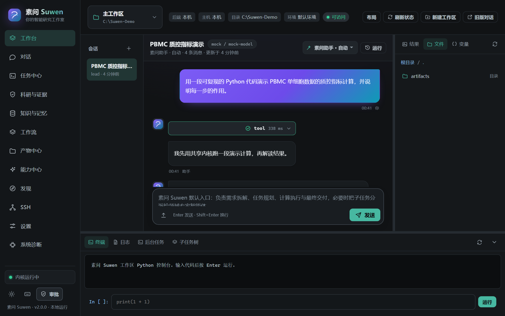
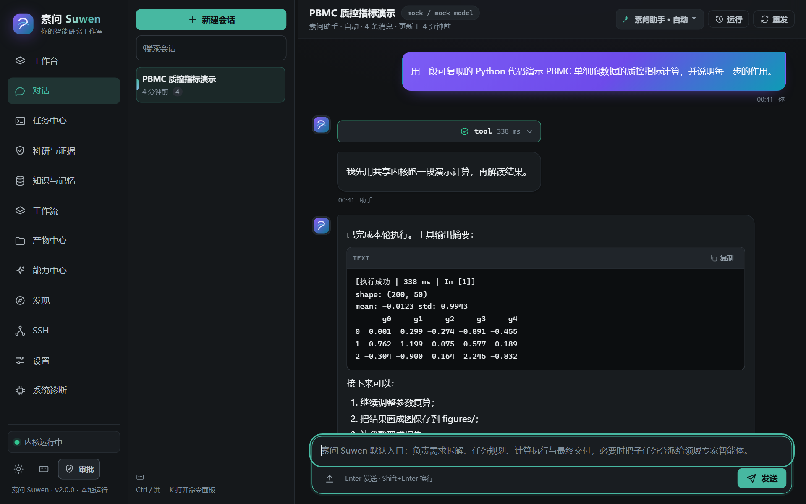
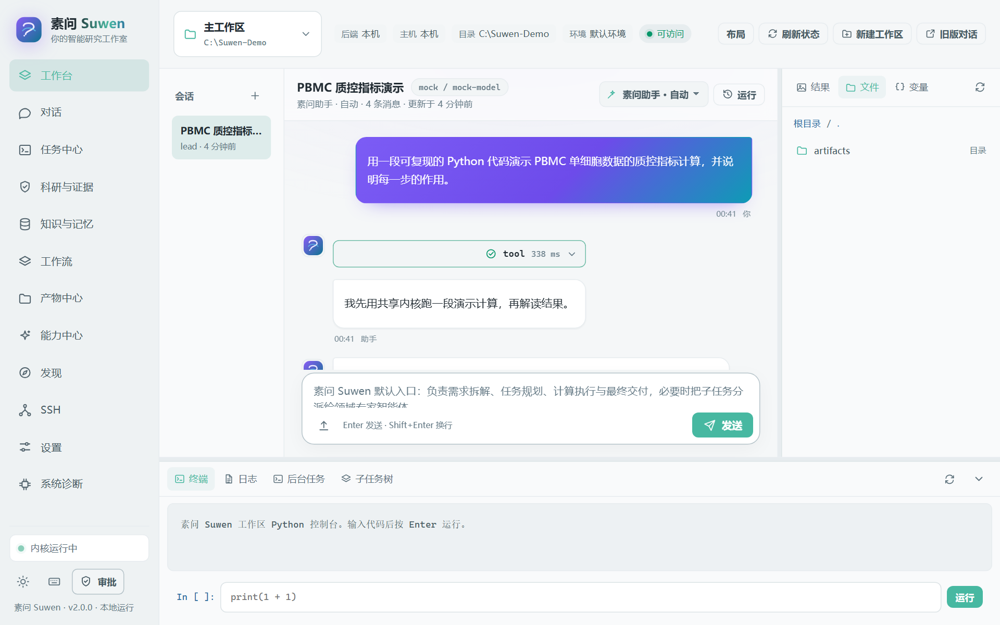
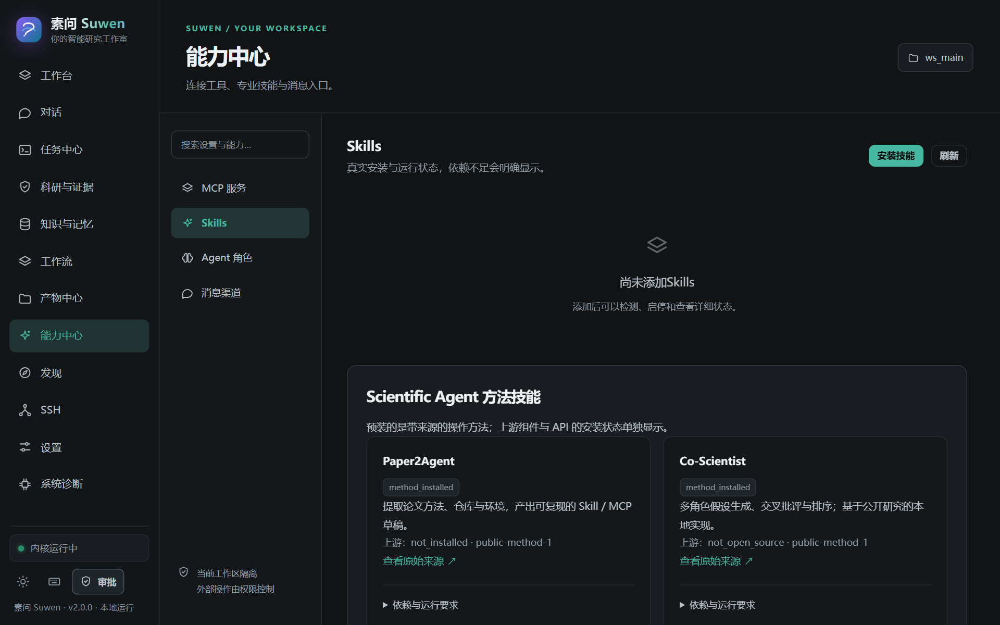
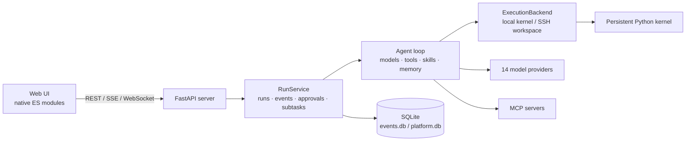
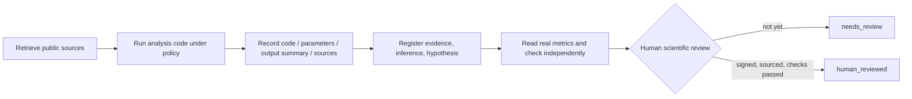

<p align="center"></p>

<h1 align="center">Suwen (素问)</h1>

<p align="center"><strong>A local-first AI agent workspace for everyday work and research.</strong></p>

<p align="center"><a href="README.md">简体中文</a> · <strong>English</strong></p>

<p align="center">
  <a href="LICENSE"></a>
  
  
  <a href="https://github.com/ForrestGump618/suwen/actions/workflows/ci.yml"></a>
</p>

Suwen is a **local-first** AI agent workspace. You open a workbench in the browser and let agents write code, run Python, work with files, queue long-running jobs, and record research conclusions in an auditable evidence chain — inside a local directory or a remote directory on an SSH host.

The server listens on `127.0.0.1` by default. There is no login, no tenancy, and no telemetry. Conversations, events, artifacts, and snapshots live on your disk as SQLite, JSON, Markdown, and PNG files that you can inspect, copy, and back up. Model providers are configured explicitly; with no provider configured, you can still walk through the flow offline with the `mock` provider.

This is version **2.0.0** (2026-10-23). The product is now named Suwen (素问), while the Python package name (`omicslab`), legacy APIs, and the `.omicslab` data directory are kept for compatibility. Per-item status for the 24 V2 requirements is tracked in the [implementation checklist](docs/SUWEN-V2-CHECKLIST.md): only branding and multi-level settings are marked "implemented"; the rest are partially implemented or limited by external environments.

<p align="center"></p>
<p align="center"><sub>The workbench: chat, variables, files, figures, and jobs share one workspace.</sub></p>

## Contents

- [Why Suwen](#why-suwen)
- [Features](#features)
- [Quick start](#quick-start)
- [Screenshots](#screenshots)
- [Architecture](#architecture)
- [Research and evidence gates](#research-and-evidence-gates)
- [Documentation](#documentation)
- [Status and validation](#status-and-validation)
- [Contributing](#contributing)
- [License and citation](#license-and-citation)
- [References and acknowledgements](#references-and-acknowledgements)

## Why Suwen

Most AI chat tools stop at one question and one answer. Suwen is built for work that has to keep going: it puts the conversation inside a real workspace and makes every execution recoverable and traceable.

- **Your data stays local by default.** The server binds to loopback only, ships no telemetry and no CDN dependencies, and does not call out at startup. Outbound requests only happen for the model providers, MCP servers, SSH hosts, and webhooks you configure.
- **It is a runtime, not just a chat box.** Every turn is a run whose events are written to SQLite before they are broadcast. Disconnected streams resume, and after a process restart unfinished runs are reconciled as `interrupted` rather than being presented as successes.
- **Capabilities are readable Markdown.** The 23 built-in skills and 13 built-in agents are frontmatter Markdown files that can be overridden per workspace without touching core code. Only skill metadata is injected into context; full instructions are loaded on demand.
- **Research conclusions take a separate path.** A successful script only proves the computation ran. A conclusion must pass source registration, numeric checks, and human review before it can be recorded as reviewed.
- **Models and services are replaceable.** There are 14 providers, including local Ollama and an offline `mock`. Tools, execution backends, skills, and agents all have explicit extension points.

Suwen is aimed at individual researchers, students, and small teams who repeatedly analyze data on a laptop or a remote server, and at developers who want their documents, data, and execution records to stay in one workspace.

## Features

### One workspace, many views

- The workbench keeps chat, variable browser, files, figures, jobs, and terminal in one scope over a shared kernel state, so data does not have to be re-read every turn.
- The web UI is a static, native ES-modules app: **no build step and no CDN**. It has 20 page routes: 12 sidebar pages plus 8 internal panels opened from the workbench.
- A command palette, light/dark/system themes, font size, density, accent color, and workspace panel layout are all configurable.

### Runs you can recover

- One run per turn: events are written to SQLite (WAL, schema v3) before they are broadcast. SSE streams can be replayed from an `after_seq` cursor and fall back to a heartbeat after 15 seconds of silence.
- After a crash or restart, unfinished runs are reconciled as `interrupted` (`meta.recovered=true`); results are never guessed.
- Persistent jobs: an SQLite queue with pause, cancel, and resume; node checkpoints; DAG dependencies and parallelism; idempotency keys; timeouts and restart markers.
- Visual workflows: a draggable DAG with model, tool, condition, parallel, approval, and output nodes. Templates can be saved and re-run.
- Sub-agent delegation, mid-run steering messages, and multi-role debate DAGs.

### Skills, agents, and tools

- **23 skills** cover single-cell upstream and downstream work, spatial transcriptomics, flow cytometry, bulk transcriptomics, cheminformatics, GEO public data, statistical rigor, causal inference, experimental design, the RSI discovery loop, paper methods, figure style, report writing, and remote compute. See the [skill library](docs/SKILLS.md).
- **13 agents**: `lead` (default), `discovery-lead`, `hypothesis-smith`, `experiment-designer`, `evidence-critic`, `research-strategist`, `data-critic`, `figure-designer`, `report-writer`, `flow-cytometrist`, `single-cell-analyst`, `spatial-analyst`, and `remote-compute-engineer`.
- **17 built-in tools**: Python execution, shell, file read/write, skill inspection, memory management, agent delegation, background jobs, notebook export, and more. Vision, Docker sandbox, research, discovery, SSH, and MCP tools are registered on demand.
- Tool calls are checked against per-workspace and per-agent permission policies (`allow` / `ask` / `deny` / `read_only`); approvals are persisted and denials are fed back to the model.

### MCP and extension points

- MCP over stdio subprocesses and Streamable HTTP (protocol `2025-06-18`), with Tools/Resources/Prompts discovery, connection tests, timeouts, and serialized concurrency.
- Extension points are files or small amounts of Python: agents and skills are Markdown, tools are `ToolSpec` registrations, and execution backends implement `ExecutionBackend`.
- Skills can be installed, enabled/disabled, and rolled back. Sources are local directories or HTTPS git repositories; versions are the first 16 characters of the content digest, and **new installs are disabled by default**.

### Research evidence gates

- Claim records distinguish evidence, inference, and hypothesis. Citations must point at real source records inside the current workspace.
- Metric checks read actual JSON files in the workspace and apply numeric comparisons; model opinions play no part.
- Research runs that have not been through human review end in `needs_review`. Review requires a reviewer signature, notes, valid sources, and no failed checks. See [Research evidence](docs/BIOMEDICAL-EVIDENCE.md).

### Local and remote workspaces

- A workspace is either a local directory or a directory on an existing SSH host. Kernels, files, jobs, memory, and knowledge are scoped per workspace.
- When a remote backend is unreachable, the error is explicit (`BackendUnavailable`). **Silent fallback to local execution is forbidden.**

### Model providers

- 14 providers: DeepSeek, OpenAI, Anthropic, Qwen, Zhipu, Volcano Ark, Moonshot, Ollama, OpenRouter, SiliconFlow, Google, custom OpenAI-compatible and Anthropic-compatible endpoints, and the offline `mock` provider.
- Fast/balanced/deep modes; separate routing for text, reasoning, and code roles; independent vision and embedding endpoints; connection tests and failover.
- A local-privacy policy can restrict models to loopback addresses. Keys live in `auth.json` (DPAPI-encrypted on Windows) or environment variables, and the API only ever returns booleans such as `has_key`.

### Security and privacy

- Single-user and local-first: **there is no built-in login or authentication**, and the server listens on `127.0.0.1` by default. Do not expose it to the public internet or run it on an untrusted shared machine.
- File access uses workspace-relative paths with escape checks; tools run under permission policies, and `ask` requires manual confirmation in the UI.
- On Windows, credentials are encrypted with DPAPI. On macOS and Linux, protection relies on OS account permissions plus optional `keyring`, so credentials may need to be re-entered.
- The optional Docker sandbox applies only to an explicitly selected Python tool (no network, read-only root filesystem, non-root, resource limits) and **has not been verified against a real container**. Regular local Python and shell tools still run with your current OS user's privileges.

## Quick start

### Windows (recommended)

```powershell
Set-ExecutionPolicy -Scope CurrentUser RemoteSigned   # current user only, allows local scripts
.\scripts\bootstrap.ps1                               # add -Extras "bio" for bioinformatics libraries
.\启动工作台.ps1                                      # http://127.0.0.1:8766 by default
```

The launcher uses port **8766**, prefers the repository's `.venv` Python, and keeps its data directory in `.omicslab` under the repository (already covered by `.gitignore`). Started directly from the CLI, the default port is **5077**; pass `--port 8766` to match the launcher:

```powershell
python -m omicslab serve --port 8766
```

### macOS / Linux

```bash
chmod +x scripts/*.sh
./scripts/bootstrap.sh            # for bioinformatics libraries: --extras "bio"
python -m omicslab serve --port 8766
```

### Any platform: pip install

Python ≥ 3.10 is required (3.11 or 3.12 recommended):

```bash
python -m venv .venv
. .venv/bin/activate                 # Windows: .venv\Scripts\activate
python -m pip install -e .           # for bioinformatics libraries: -e ".[bio]"
python -m omicslab serve             # CLI default: http://127.0.0.1:5077
```

Open the address printed in the terminal (5077 by default). Run `python -m omicslab env` (alias `doctor`) for a health check; add `--json` for scripts. Offline installs, Jupyter kernel interpreter selection, long paths, and firewall notes are covered in the [installation guide](docs/INSTALL.md) and the [FAQ](docs/FAQ.md).

### First steps

1. **Settings → Models**: pick a provider and enter an API key. If you do not want to connect a real model yet, use `mock` to walk through the flow (it returns deterministic sample content and does not reflect real model capability).
2. **Workspaces**: create a local workspace, or open an existing SSH host directory as a workspace from the SSH page.
3. **Workbench**: just ask. Analyses that need a record belong in the job center and the research/evidence area, where conclusions and sources are stored in the workspace.

## Screenshots

<p align="center">
  
  
</p>
<p align="center"><sub>Left: chat and tool calls. Right: research and evidence.</sub></p>

<p align="center">
  
  
</p>
<p align="center"><sub>The same UI supports light and dark themes; skills, agents, and MCP servers are managed under Extensions.</sub></p>

## Architecture

The browser side is a static SPA and the server side is a FastAPI app. The runtime layer turns a conversation into recoverable runs, while the execution layer puts the local kernel and SSH hosts behind one interface.



| Layer | Location | Responsibility |
|---|---|---|
| Web UI | `omicslab/web/**` | Native ES-modules SPA, 20 routes, no build step |
| Server | `omicslab/server/**` | FastAPI + uvicorn, REST/SSE/WS, origin checks, singleton services |
| Runtime | `omicslab/runtime/**` | `RunService`, `EventStore`, approvals, subtasks |
| Agent | `omicslab/agent/**` | Agent loop, providers, tool registry, skills, memory |
| Execution | `omicslab/execution/**` | Local and SSH backends; remote failures never fall back to local |
| Kernel | `omicslab/kernel/**` | Persistent IPython kernel, variable introspection, figure capture |
| Data | `~/.omicslab` and workspaces | SQLite, JSON, Markdown, PNG |

Component details, the request lifecycle, concurrency and cancellation, and error degradation are in the [architecture guide](docs/ARCHITECTURE.md); the HTTP surface is in the [API reference](docs/API.md).

## Research and evidence gates

What sets Suwen apart is that a research conclusion is not considered done just because the code ran. This release ships a small set of independently written research tools organized after Biomni's ideas of tool retrieval and evidence gating: `bio_literature_search` and `bio_protein_lookup` make real Europe PMC and UniProt requests and store source metadata, `bio_sequence_check` performs deterministic local sequence checks, `bio_record_claim` separates evidence from inference and hypothesis, and `bio_verify_claim` compares actual metric files in the workspace against numeric rules.



- Passing numeric checks earns at most `checks_passed_needs_human`; missing sources or failed checks yield `insufficient_evidence`.
- Research jobs, or runs with registered claims, end as `needs_review` until human review completes. Models and tools cannot sign off on their own.
- This package does **not** bundle the full Biomni E1 environment or data lake, and does not reproduce its benchmark results. Paper2Agent, AI Co-Scientist, Robin, and Empirical Research Assistance are self-authored method skills, not installations of the upstream systems.
- No paid model was used for real research during validation, so the project publishes no new biological conclusions.

A full description, including a reviewable metrics-file example, is in [Research evidence](docs/BIOMEDICAL-EVIDENCE.md).

## Documentation

| Document | Contents |
|---|---|
| [Documentation index](docs/README.md) | Entry points for users, researchers, developers, and maintainers |
| [Installation](docs/INSTALL.md) | Install, optional dependencies, offline installs, kernel interpreters, Windows notes |
| [Operations](docs/SUWEN-V2-GUIDE.md) | Startup flags, data directories, model config, SSH workspaces, jobs and backups |
| [Architecture](docs/ARCHITECTURE.md) | Components, request lifecycle, storage layout, concurrency, security boundaries |
| [API reference](docs/API.md) | REST and SSE endpoints, error codes, run recovery |
| [Extending](docs/EXTENDING.md) | Custom agents, skills, memory, tools, execution backends, LLM endpoints |
| [Skill library](docs/SKILLS.md) | Skill catalog, triggers, and output checks |
| [Implementation checklist](docs/SUWEN-V2-CHECKLIST.md) | Per-item status of the 24 requirements, the single source of truth |
| [Validation record](docs/VALIDATION-V2.md) | Automated regression and real-environment test scope |
| [Roadmap](docs/ROADMAP.md) | Status-based roadmap and ways to contribute |
| [FAQ](docs/FAQ.md) | Installation, ports, keys, data locations, and other common questions |
| [Research evidence](docs/BIOMEDICAL-EVIDENCE.md) | Tool implementation, evidence levels, human review gates |
| [References](docs/REFERENCES-V2.md) | What was referenced, what is not bundled, license boundaries |
| [Changelog](CHANGELOG.md) | 2.0.0 and earlier releases |

## Status and validation

- Current version **2.0.0** (2026-10-23), semantic versioning; only the latest 2.0.x receives fixes.
- **Tests**: `python -m pytest -q` → **439 passed** in about 35 seconds (Windows, Python 3.12.11). The result was re-run and confirmed locally, and the 439-test run recorded in the [validation record](docs/VALIDATION-V2.md) is the project's 2.0.0 baseline. Results can differ slightly by platform and dependency versions, so treat your local output as authoritative.
- CI ([`ci.yml`](.github/workflows/ci.yml)) runs the same suite on Ubuntu (Python 3.10/3.11/3.12) and Windows (3.12). Tests are fully offline and use the `mock` provider.
- Status language is consistent everywhere: **implemented**, **partially implemented**, **not implemented**, **limited by external environments**, matching the [implementation checklist](docs/SUWEN-V2-CHECKLIST.md).
- Not yet externally validated: end-to-end SSH, real paid models/vision/embeddings, real Docker containers, Telegram and OAuth flows, and upstream research environments. macOS/Linux install scripts are provided but the maintainers have no matching hosts and have not tested them.
- Suwen targets a single user on a single machine and is **not** suitable as a public multi-tenant service.

## Contributing

Contributions are not limited to code: bug reports, documentation fixes, real-environment validation, and new agents or skills are all valuable.

- Adding an agent or skill only requires a Markdown file; see the [extending guide](docs/EXTENDING.md).
- Development: run `.\scripts\bootstrap.ps1 -Extras dev` or `./scripts/bootstrap.sh --extras dev`, then `python -m pytest -q`.
- Read the [contributing guide](CONTRIBUTING.md) and the [code of conduct](CODE_OF_CONDUCT.md) before submitting. Report security issues privately through [SECURITY.md](SECURITY.md) — do not open a public issue.
- Bug reports should include the version (`python -m omicslab --version`), OS, Python version, and redacted logs.
- Maintainer responses are best-effort; this is an individual/small-team project with no SLA.

## License and citation

Released under the [Apache-2.0](LICENSE) license.

If you use Suwen in research or in a product, please cite it as described in [`CITATION.cff`](CITATION.cff). Upstream projects referenced here keep their own licenses; referencing them does not make them dependencies of this package.

## References and acknowledgements

Suwen's design was informed by the following public work (reading and design reference only; no third-party code, prompts, or branding was copied): [Biomni](https://github.com/snap-stanford/Biomni) for tool retrieval and evidence gating, [Paper2Agent](https://github.com/jmiao24/Paper2Agent), [AI Co-Scientist](https://arxiv.org/abs/2502.18864), [Robin](https://github.com/Future-House/robin), and [Empirical Research Assistance](https://arxiv.org/abs/2509.06503). Interface and workflow organization drew on [Dify](https://github.com/langgenius/dify), [Open WebUI](https://github.com/open-webui/open-webui), [OpenHands](https://github.com/OpenHands/OpenHands), [VS Code Remote SSH](https://code.visualstudio.com/docs/remote/ssh), and [MCP transports](https://modelcontextprotocol.io/specification/2025-06-18/basic/transports). Real data sources include [Europe PMC](https://europepmc.org/RestfulWebService) and [UniProt](https://www.uniprot.org/help/api).

The complete list and boundary statements are in [References and licenses](docs/REFERENCES-V2.md).

---

Suwen v2.0.0 · Apache-2.0 · This page mirrors [README.md](README.md) in structure
