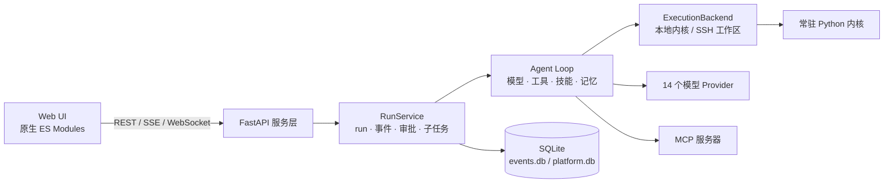
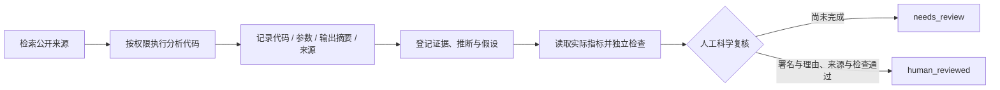

<p align="center"></p>

<h1 align="center">素问 Suwen</h1>

<p align="center"><strong>本地优先的 AI Agent 工作室，面向日常工作与科研。</strong></p>

<p align="center"><strong>简体中文</strong> · <a href="README.en.md">English</a></p>

<p align="center">
  <a href="LICENSE"></a>
  
  
  <a href="https://github.com/ForrestGump618/suwen/actions/workflows/ci.yml"></a>
</p>

素问 Suwen 是一个**本地优先**的 AI Agent 工作室：在浏览器里打开一个工作台，让智能体在你的本机目录或 SSH 主机的远端目录里写代码、跑 Python、读写文件、提交长任务，并把科研结论纳入一条可审查的证据链。

服务默认只监听 `127.0.0.1`，没有登录、没有租户、没有遥测；会话、事件、产物与快照都以 SQLite、JSON、Markdown、PNG 的形式落在本机，可以直接查看、复制与备份。模型接入是显式配置的，不配模型也能用 `mock` 离线走通流程。

当前版本 **2.1.0**（2026-10-24）。展示名已改为素问 Suwen，Python 包名（`omicslab`）、旧 API 与数据目录 `.omicslab` 为兼容而保留。24 类 V2 需求逐项状态与尚缺子项见 [实现清单](docs/SUWEN-V2-CHECKLIST.md)：其中只有品牌与多级设置标为“已实现”，其余是“部分实现”或受外部环境限制。

<p align="center"></p>
<p align="center"><sub>工作台：对话、变量、文件、图表与任务共用同一个工作区。</sub></p>

> **2.1 新增**：Sage-A1.5 自检协议、可选并行子任务、独立指标验证节点、实验比较与工作流导入导出。已有文档结构和品牌保持不变；适配方式与实际边界见 [第二轮升级说明](docs/UPGRADE-2.1.md)。

## 目录

- [为什么是素问](#为什么是素问)
- [功能特性](#功能特性)
- [快速开始](#快速开始)
- [界面速览](#界面速览)
- [架构](#架构)
- [科研与证据门控](#科研与证据门控)
- [文档](#文档)
- [项目状态与验证](#项目状态与验证)
- [参与贡献](#参与贡献)
- [许可证与引用](#许可证与引用)
- [参考与致谢](#参考与致谢)

## 为什么是素问

大多数 AI 对话工具停在一问一答。素问想解决的是“工作能不能在这里持续做完”——所以它把对话放在一个真实的工作区里，并让每次执行都可恢复、可追溯。

- **数据默认不出本机。** 服务只监听回环地址，无遥测、无 CDN、启动时不主动外联；外部请求只发生在你显式配置的模型、MCP、SSH 与 Webhook 上。
- **不是聊天框，是能持续工作的运行环境。** 每个回合都是一次 run，事件先落 SQLite 再广播；断线可续传，进程重启后未完成的运行会被标记为 `interrupted`，不会伪装成成功。
- **能力是可读的 Markdown。** 23 个内置技能、13 个内置智能体都是带 frontmatter 的 Markdown 文件，可按工作区覆盖，不需要改核心代码；默认只把技能目录注入上下文，正文按需读取。
- **科研结论单独走证据链。** 代码跑通只说明计算成功；结论要经过来源登记、数值检查与人工复核，才可能被标为已复核。
- **模型与服务都可替换。** 14 个 Provider，含本地 Ollama 与离线 `mock`；工具、执行后端、技能、智能体都有明确的扩展点。

适合的使用者：需要在本机或远程服务器上反复做分析的个人研究者、学生与小团队，以及希望把文档、数据与执行记录留在一个工作区里的开发者。

## 功能特性

### 一个工作区，多个视图

- 工作台把对话、变量浏览器、文件、图表、任务与终端放在同一个作用域里，共享同一份内核状态，不必每轮重新读数据。
- Web UI 是纯静态的原生 ES Modules 应用：**没有构建步骤、没有 CDN**，20 个页面路由（12 个侧栏页面 + 8 个从工作台进入的内部面板）。
- 命令面板、明 / 暗 / 跟随系统主题、字体字号、密度、强调色与面板布局都可调整。

### 运行可恢复

- 每回合一次 run：事件先写入 SQLite（WAL，schema v3）再广播；SSE 断线可按 `after_seq` 重放，空闲 15 秒发送心跳。
- 进程崩溃或重启后，未完成的 run 对账为 `interrupted`（`meta.recovered=true`），不猜测结果。
- 持久任务中心：SQLite 队列、暂停 / 取消 / 恢复、节点 Checkpoint、DAG 依赖与并行、幂等键、超时与重启标记。
- 可视工作流：可拖动的 DAG，包含模型、工具、条件、并行、审批与输出节点，模板可保存并反复运行。
- 子智能体委派、运行中追加指示（steering）与多角色讨论 DAG。

### 技能、智能体与工具

- **23 个技能**：单细胞上游 / 下游、空间转录组、流式细胞术、bulk 转录组、化学信息学、GEO 公共数据、统计严谨性、因果推断、实验设计、RSI 发现循环、论文方法、图表风格、报告写作、远程算力等。目录见 [内置技能库](docs/SKILLS.md)。
- **13 个智能体**：`lead`（默认）、`discovery-lead`、`hypothesis-smith`、`experiment-designer`、`evidence-critic`、`research-strategist`、`data-critic`、`figure-designer`、`report-writer`、`flow-cytometrist`、`single-cell-analyst`、`spatial-analyst`、`remote-compute-engineer`。
- **17 个内置工具**：Python 执行、Shell、文件读写、技能查看、记忆管理、智能体委派、后台任务、notebook 导出等；另有视觉、Docker 沙箱、科研、发现、SSH 与 MCP 工具按需注册。
- 工具调用前按工作区 / Agent 权限策略检查（`allow` / `ask` / `deny` / `read_only`），审批记录持久化，拒绝结果会回填给模型。

### MCP 与扩展点

- MCP 支持 stdio 子进程与 Streamable HTTP（协议 `2025-06-18`），可发现 Tools / Resources / Prompts，带连接测试、超时与串行控制。
- 扩展点全部是文件或少量 Python：智能体与技能是 Markdown，工具是 `ToolSpec` 注册项，执行后端实现 `ExecutionBackend`。
- 技能支持安装、启用 / 停用与回滚：来源可为本地目录或 HTTPS Git，版本取内容摘要前 16 位，**新安装默认停用**。

### 科研证据门控

- 结论登记区分 evidence / inference / hypothesis，引文必须指向当前工作区里真实存在的来源记录。
- 指标检查读取工作区中的真实 JSON 数据，按预设规则做数值比较，与模型意见无关。
- 未完成人工复核的科研运行会停在 `needs_review`；复核要求署名、理由、有效来源与无失败检查。详见 [科研证据设计](docs/BIOMEDICAL-EVIDENCE.md)。

### 本地与远程工作区

- 工作区可以是本地目录，也可以是已有 SSH 主机的某个远端目录；内核、文件、任务、记忆与知识按工作区分区。
- 远端不可达时明确报错（`BackendUnavailable`），**禁止静默回退到本机执行**。

### 模型接入

- 14 个 Provider：DeepSeek、OpenAI、Anthropic、通义千问、智谱、火山方舟、Moonshot、Ollama、OpenRouter、SiliconFlow、Google，以及自定义 OpenAI / Anthropic 兼容端点与离线 `mock`。
- 快速 / 均衡 / 深度三种模式；文本、推理、代码角色可分别路由；视觉与嵌入端点独立配置；支持连接实测与故障切换。
- 本地隐私策略可只允许回环地址上的模型；密钥存在 `auth.json`（Windows 上用 DPAPI 加密）或环境变量里，API 只返回 `has_key` 之类的布尔值。

### 安全与隐私

- 单用户、本地优先：**没有内置登录与鉴权**，默认只监听 `127.0.0.1`；不要把它暴露到公网或多用户共享机器上。
- 文件访问走工作区相对路径并做越界校验；工具按权限策略执行，`ask` 需要界面人工确认。
- Windows 上凭据由 DPAPI 加密保存；macOS / Linux 依赖系统账户权限与可选的 `keyring`，随时可能需要重新输入。
- 可选 Docker 沙箱仅对显式选择 Python 工具生效（断网、只读根文件系统、非 root、限额），**未做真实容器验收**；常规本机 Python / Shell 仍等价于当前操作系统用户权限。

## 快速开始

### Windows（推荐）

```powershell
Set-ExecutionPolicy -Scope CurrentUser RemoteSigned   # 仅当前用户，允许执行本地脚本
.\scripts\bootstrap.ps1                               # 需要生物分析库时追加 -Extras "bio"
.\启动工作台.ps1                                      # 默认 http://127.0.0.1:8766
```

`启动工作台.ps1` 使用 **8766** 端口，优先仓库内 `.venv` 的 Python，并把数据目录设在仓库下的 `.omicslab`（已被 `.gitignore` 覆盖）。若直接用命令行启动，CLI 默认端口是 **5077**；要与启动脚本保持一致，显式指定即可：

```powershell
python -m omicslab serve --port 8766
```

### macOS / Linux

```bash
chmod +x scripts/*.sh
./scripts/bootstrap.sh            # 需要生物分析库：--extras "bio"
python -m omicslab serve --port 8766
```

### 任意平台：pip 安装

需要 Python ≥ 3.10（推荐 3.11 或 3.12）：

```bash
python -m venv .venv
. .venv/bin/activate                 # Windows: .venv\Scripts\activate
python -m pip install -e .           # 需要生物分析库：-e ".[bio]"
python -m omicslab serve             # CLI 默认 http://127.0.0.1:5077
```

打开终端里打印的地址即可（默认 5077）。健康检查用 `python -m omicslab env`（别名 `doctor`），`--json` 便于脚本处理。离线安装、Jupyter 内核解释器选择、Windows 长路径与防火墙等细节见 [安装指南](docs/INSTALL.md) 与 [常见问题](docs/FAQ.md)。

### 首次使用三步

1. **设置 → 模型**：选一个厂商并填 API Key；暂时不接入真实模型时，可以用 `mock` 体验流程（只返回确定性的示例内容，不代表真实模型能力）。
2. **工作区**：新建本地工作区，或在 SSH 页把已有主机的某个目录“作为工作区打开”。
3. **工作台**：直接提任务。需要留痕的分析交给“任务中心”和“科研与证据”，结论与来源会记录在工作区里。

## 界面速览

<p align="center">
  
  
</p>
<p align="center"><sub>左：对话与工具调用；右：科研与证据。</sub></p>

<p align="center">
  
  
</p>
<p align="center"><sub>同一套界面支持明暗主题；技能、智能体与 MCP 在“扩展”里管理。</sub></p>

## 架构

浏览器端是纯静态 SPA，服务端是 FastAPI 应用；运行层把“一次对话”变成可恢复的 run，执行层则把本机内核与 SSH 远端统一到同一个接口下。



| 层 | 位置 | 职责 |
|---|---|---|
| Web UI | `omicslab/web/**` | 原生 ES Modules SPA，20 个路由，无构建步骤 |
| 服务层 | `omicslab/server/**` | FastAPI + uvicorn，REST / SSE / WS，Origin 校验与单例服务 |
| 运行层 | `omicslab/runtime/**` | `RunService`、`EventStore`、审批与子任务 |
| 智能体 | `omicslab/agent/**` | Agent Loop、Provider、工具注册表、技能、记忆 |
| 执行层 | `omicslab/execution/**` | 本地 / SSH 执行后端，远端失败不回退本地 |
| 内核 | `omicslab/kernel/**` | 常驻 IPython 内核、变量内省、图表落盘 |
| 数据 | `~/.omicslab` 与工作区 | SQLite、JSON、Markdown、PNG |

完整组件清单、请求生命周期、并发与取消、错误降级见 [架构说明](docs/ARCHITECTURE.md)；接口参考见 [API 文档](docs/API.md)。

## 科研与证据门控

素问的差异化在于“结论不只看代码跑没跑通”。本版本独立编写了一组轻量科研工具，组织方式参考了 Biomni 的工具检索与证据门控思路：`bio_literature_search` 与 `bio_protein_lookup` 会实际请求 Europe PMC 与 UniProt 并保存来源元数据，`bio_sequence_check` 在本地做确定性的序列检查，`bio_record_claim` 区分证据、推断与假设，`bio_verify_claim` 读取工作区中的真实指标文件做数值比较。



- 数值检查通过最多得到 `checks_passed_needs_human`；来源不足或检查失败记为 `insufficient_evidence`。
- 科研任务或存在结论登记的运行，未完成人工复核时持久任务终态为 `needs_review`；模型与工具无权自动签署复核。
- 本包**没有**打包完整 Biomni E1 环境或数据湖，也没有复现其评测表现；Paper2Agent、AI Co-Scientist、Robin、Empirical Research Assistance 是自编的方法技能，不是上游系统的安装版。
- 维护者的验证中没有使用付费模型做真实研究，因此项目不提供任何新的生物学结论。

完整说明与可复查的指标文件示例见 [生物医学执行与证据验证](docs/BIOMEDICAL-EVIDENCE.md)。

## 文档

| 文档 | 内容 |
|---|---|
| [文档索引](docs/README.md) | 按“使用者 / 研究者 / 开发者 / 维护者”组织的入口 |
| [安装指南](docs/INSTALL.md) | 安装、可选依赖、离线安装、内核解释器、Windows 注意事项 |
| [运行与维护](docs/SUWEN-V2-GUIDE.md) | 启动参数、数据目录、模型配置、SSH 工作区、任务与备份 |
| [架构说明](docs/ARCHITECTURE.md) | 组件、请求生命周期、落盘位置、并发与安全边界 |
| [API 参考](docs/API.md) | REST + SSE 接口、错误码与运行恢复 |
| [扩展指南](docs/EXTENDING.md) | 自定义 Agent、Skill、Memory、工具、执行后端与 LLM 端点 |
| [内置技能库](docs/SKILLS.md) | 技能目录、触发时机与产出检查 |
| [实现清单](docs/SUWEN-V2-CHECKLIST.md) | 24 类需求的逐项状态，实现状态的唯一事实来源 |
| [验证记录](docs/VALIDATION-V2.md) | 自动回归与真实环境实测范围 |
| [路线图](docs/ROADMAP.md) | 按实现状态整理的路线图与参与方式 |
| [常见问题](docs/FAQ.md) | 安装、端口、密钥、数据位置等高频问题 |
| [科研证据设计](docs/BIOMEDICAL-EVIDENCE.md) | 工具实现、证据分级与人工复核门控 |
| [参考与边界](docs/REFERENCES-V2.md) | 借鉴了什么、没有打包什么、许可证边界 |
| [更新日志](CHANGELOG.md) | 2.1.0 与历史版本变更 |

## 项目状态与验证

- 当前版本 **2.1.0**（2026-10-24），采用语义化版本；修复只覆盖最新的 2.0.x。
- **测试**：`python -m pytest -q` → **446 passed**（Windows + Python 3.12.11，约 35 秒）。该结果已在维护者本机复跑确认；[验证记录](docs/VALIDATION-V2.md) 中的 446 项是项目 2.1.0 的基线记录。不同平台与依赖版本可能略有差异，以本机实际输出为准。
- CI（[`ci.yml`](.github/workflows/ci.yml)）在 Ubuntu（Python 3.10 / 3.11 / 3.12）与 Windows（3.12）上运行同一套测试；测试完全离线，模型使用 `mock`。
- 状态用词统一为 **已实现**、**部分实现**、**待实现**、**外部依赖限制**，与 [实现清单](docs/SUWEN-V2-CHECKLIST.md) 保持一致。
- 尚未完成的外部验收：真实 SSH 端到端、真实付费模型 / 视觉 / 嵌入、Docker 容器、Telegram 与 OAuth 授权、上游科研环境；macOS / Linux 安装脚本已提供，但维护者没有对应主机，尚未实测。
- 项目面向单机单用户，**不适合**直接作为公网多租户服务。

## 参与贡献

贡献不限于写代码：报告问题、修文档、补充真实环境验证、新增 Agent 或 Skill 都很重要。

- 新增 Agent / Skill 只需要添加一个 Markdown 文件，见 [扩展指南](docs/EXTENDING.md)。
- 开发环境：`.\scripts\bootstrap.ps1 -Extras dev` 或 `./scripts/bootstrap.sh --extras dev`，然后 `python -m pytest -q`。
- 提交前请阅读 [贡献指南](CONTRIBUTING.md) 与 [行为准则](CODE_OF_CONDUCT.md)；安全问题按 [安全政策](SECURITY.md) 私下报告，**不要**开公开 Issue。
- Bug 报告请附版本（`python -m omicslab --version`）、操作系统、Python 版本与脱敏后的日志。
- 维护者按 best-effort 响应，这是个人 / 小团队项目，没有 SLA。

## 许可证与引用

本项目以 [Apache-2.0](LICENSE) 许可证发布。

如果在研究或产品中使用素问，请按 [`CITATION.cff`](CITATION.cff) 引用。参考的上游项目按各自许可证使用，不因本项目而改变，也不构成本包依赖。

## 参考与致谢

素问的实现参考了以下公开工作（仅作阅读与设计参考，未安装、未复制其代码或品牌）：[Biomni](https://github.com/snap-stanford/Biomni) 的工具检索与证据门控思路、[Paper2Agent](https://github.com/jmiao24/Paper2Agent)、[AI Co-Scientist](https://arxiv.org/abs/2502.18864)、[Robin](https://github.com/Future-House/robin)、[Empirical Research Assistance](https://arxiv.org/abs/2509.06503)；界面与工作流组织方面参考了 [Dify](https://github.com/langgenius/dify)、[Open WebUI](https://github.com/open-webui/open-webui)、[OpenHands](https://github.com/OpenHands/OpenHands)、[VS Code Remote SSH](https://code.visualstudio.com/docs/remote/ssh) 与 [MCP transports](https://modelcontextprotocol.io/specification/2025-06-18/basic/transports)。真实数据来源包括 [Europe PMC](https://europepmc.org/RestfulWebService) 与 [UniProt](https://www.uniprot.org/help/api)。

更完整的清单与边界声明见 [参考项目与许可证](docs/REFERENCES-V2.md)。

---

素问 Suwen v2.1.0 · Apache-2.0 · 本页与 [README.en.md](README.en.md) 保持结构对应
