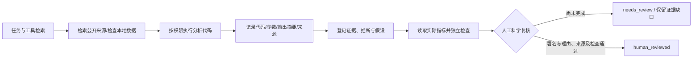

# 生物医学执行与证据验证

## Biomni 的取舍

用户提供的知乎文章在此环境返回 403，因此转为阅读 [Biomni 官方仓库](https://github.com/snap-stanford/Biomni) 与其 [工具注册代码](https://github.com/snap-stanford/Biomni/blob/main/biomni/tool/tool_registry.py)。本版本借鉴工具检索、任务规划、代码执行与可复现记录的组织方式，独立编写轻量工具；没有下载完整 E1 环境、数据湖或宣称达到 Biomni 评测表现。上游组件后续可通过实际 MCP 服务授权接入。

| 工具 | 实际实现 | 如何判断结果 |
|---|---|---|
| `bio_tool_search` | 按工具描述和任务词检索本地目录 | 只返回本包实际工具及依赖 |
| `bio_literature_search` | Europe PMC REST 实际请求 | 保存标题、摘要、DOI、PMID、URL、检索时间和撤稿标志；元数据取得不代表支持特定结论 |
| `bio_protein_lookup` | UniProt REST 实际请求 | 保存 accession、基因、物种、注释与来源；注释不证明因果关系 |
| `bio_sequence_check` | 本地确定性 DNA 长度/GC/模糊碱基/反向互补检查 | 非法字符单独标记；N 不纳入 GC 分母，全 N 返回空比例 |
| `run_python_code` | 选定本地/SSH 工作区内核 | 保存代码、参数/输出摘要、运行状态；执行成功与科学正确分开 |
| `bio_record_claim` | 区分 evidence / inference / hypothesis | 引文 ID 必须属于当前工作区的实际来源记录；不能随意编造 ID |
| `bio_verify_claim` | 读取当前工作区真实 JSON 指标文件 | 对有限数值执行 lt/le/gt/ge/eq，与模型意见无关；保留文件摘要、数值与规则 |

## 流程中的门控



工具结果写入 provenance，聊天结束时做 evidence gate。科研任务或存在结论登记的运行，未完成人工科学复核时追加待复核提示，持久任务结束状态为 `needs_review`。直接工具节点也保存执行记录并检查证据门控。自动科研识别包含启发式，不应被当成自然语言结论识别的完备保证。

数值检查通过最多得到 `checks_passed_needs_human`；来源不足或检查失败得到 `insufficient_evidence`。`human_reviewed` 仅表示本机用户已署名复核，没有冒充独立专家或验证签署人身份。模型工具无权自动调用人工复核入口。

## 一个可复查的指标文件

工作区中实际保存 `results/metrics.json`：

```json
{
  "adjusted_p_value": 0.01,
  "independent_validation_samples": 20
}
```

上面仅是格式示例，数值并非任何真实生物学发现。登记来源后，在科研与证据中为某条结论执行：

```json
[
  {"metric":"adjusted_p_value","op":"lt","threshold":0.05},
  {"metric":"independent_validation_samples","op":"ge","threshold":10}
]
```

规则的阈值需要事先有研究设计依据；文件里有一个显著 P 值，不能证明样本独立、正确控制混杂或具有生物学效应。人工复核应检查数据来源、样本分组、批次、效应量、多重检验、验证集泄漏、负对照、引文是否真正支持论断，以及能否重跑分析。

## API

当前工作区 ID 用 `scope=ws_main` 表示，远程工作区使用实际 ID。

- `GET /api/platform/biomedical`：实际集成与上游安装状态。
- `POST /api/platform/biomedical/tools`：`{"query":"蛋白注释"}`。
- `POST /api/platform/research/literature?scope=...`：`{"query":"BRCA1","limit":5}`。
- `POST /api/platform/biomedical/protein?scope=...`：`{"accession":"P04637"}`。
- `POST /api/platform/research/claims?scope=...`：`statement/kind/sources/run`。
- `POST /api/platform/research/claims/{id}/verify?scope=...`：`path/rules`。
- `POST /api/platform/research/claims/{id}/review?scope=...`：本机人工操作，要求 `confirmed/reviewer/notes`、可追溯来源及无失败检查。
- `GET /api/platform/research?scope=...`：结论、来源、门控与执行记录。

来源接口不是临床资料上传入口。现有凭据/身份模式检测只是一层筛选，不能视作完善的临床脱敏系统。隐私模型策略禁止视觉/嵌入/文本模型调用非回环地址；普通文献查询仍需要网络权限。

## 已验证和未验证

本地测试覆盖真实 JSON 文件读取、有限数值与缺失指标、来源范围、缺少证据门控、DNA 检查。真实公开接口分别查询过 BRCA1 文献和 P04637 蛋白。显式 mock 的持久任务执行了实际 Python，但被证据门控阻止当成科研验证完成。未使用付费模型进行真实研究，不提供任何新生物学结论。
