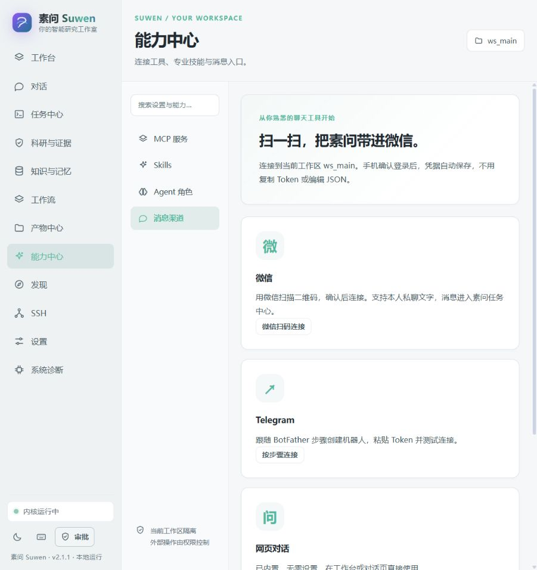

# 消息渠道设置

在 **能力中心 → 消息渠道** 中选择要连接的平台。2.1.1 起，日常接入使用表单和扫码向导，不再要求编辑渠道 JSON。

## 微信：扫一扫建立连接

1. 点击 **微信扫码连接**。名称可直接沿用，连接绑定当前工作区与默认 Agent。
2. 默认只接收消息，在素问任务中心查看结果。如需在微信收到文字回答，明确勾选“将成功完成的文字回答自动回复给扫码本人”。
3. 点击 **生成二维码**，使用手机微信扫一扫，并在手机上确认。若微信要求验证码，将手机上显示的数字填入窗口。
4. 看到“微信已连接”后，先给微信助手发送一条文字消息。随后可在任务中心观察实际执行过程。

二维码由腾讯 iLink 接口实际返回，素问只负责把内容编码成可扫描的图片。约三分钟过期，过期后点击刷新即可；关闭窗口停止登录等待。是否能够完成绑定，以手机微信的账号资格与确认结果为准。

Windows 使用系统 DPAPI 保存 Bot Token。其他系统在当前服务进程内暂存凭据，重启后需要重新扫码。连接状态与 Token 分离，二维码状态接口不返回 Token。服务端返回的重定向地址限定在受信任的微信 HTTPS 域名，禁止切换到本机或任意第三方地址。

扫码成功只允许**扫码本人**给助手发送消息，默认只读 Agent；输入进入已绑定工作区，经过相同的权限、工具守卫、自动资源治理及科学证据门禁。工作区不会因为微信消息而自动获得额外权限。

当前支持私聊文字收发。自动回复只对成功完成的任务生效；证据待复核、受控停止、审批中或失败的任务需要在素问查看和处理。群聊、图片、语音和附件尚未支持。发送前持久记录尝试，网络结果不明时不自动重发，以避免重复消息；因此网络故障可能需要人工检查漏发。

连接连续失败三次后停止后台重试，页面显示连接中断。点击“测试连接”成功后可恢复接收，凭据失效则重新扫码。后端必须保持运行；浏览器关闭不影响已连接渠道，但退出服务会停止轮询。

## Telegram：表单连接

1. 在 Telegram 打开官方 `@BotFather`，使用 `/newbot` 创建机器人。
2. 点击 **按步骤连接**，填写名称、Bot Token、允许的 Telegram 用户 ID 和 Webhook 共享密钥。多个用户 ID 可用逗号分隔。
3. 点击 **保存并测试**，实际调用 Telegram `getMe` 验证。凭据自动保存，不需要自己创建凭据引用。
4. 当前 Telegram 接收仍使用 Webhook：需要将可公开访问的 HTTPS 地址 `/api/platform/channels/<channel_id>/webhook` 注册到 Telegram，并使用相同共享密钥。`127.0.0.1` 不能直接作为公网 Webhook；页面会说明这一步，不会把认证成功当成已能接收消息。

非 Windows 环境请选择“仅在本次启动期间保存凭据”。Telegram 暂无扫码与自动长轮询，也不自动回复任务结果；已有的明确确认发送接口继续可用。

## 其他平台

网页对话已内置，无需连接。企业微信、飞书、QQ 和通用 外部项目 原生插件仍需要适配器，未提供不可用的扫码按钮。

## 验证范围与协议来源

自动测试覆盖真实二维码编码、登录状态机、跨工作区拒绝、过期与取消、Token 不出现在登录响应中、私聊联系人授权、消息去重、回复上下文、发送收据和 HTTP 错误脱敏。已对腾讯实际接口完成二维码获取；扫码确认和真实账号文字收发仍需用户在手机上验收。Telegram 测试使用协议替身，未登录真实账号。

协议依据腾讯公开的 [openclaw-weixin 文档](https://github.com/Tencent/openclaw-weixin/blob/main/docs/protocol_zh_CN.md)。本项目独立实现 HTTP 适配，没有打包或宣称完整集成 外部项目。二维码编码使用 BSD 许可的 `qrcode` Python 依赖。
