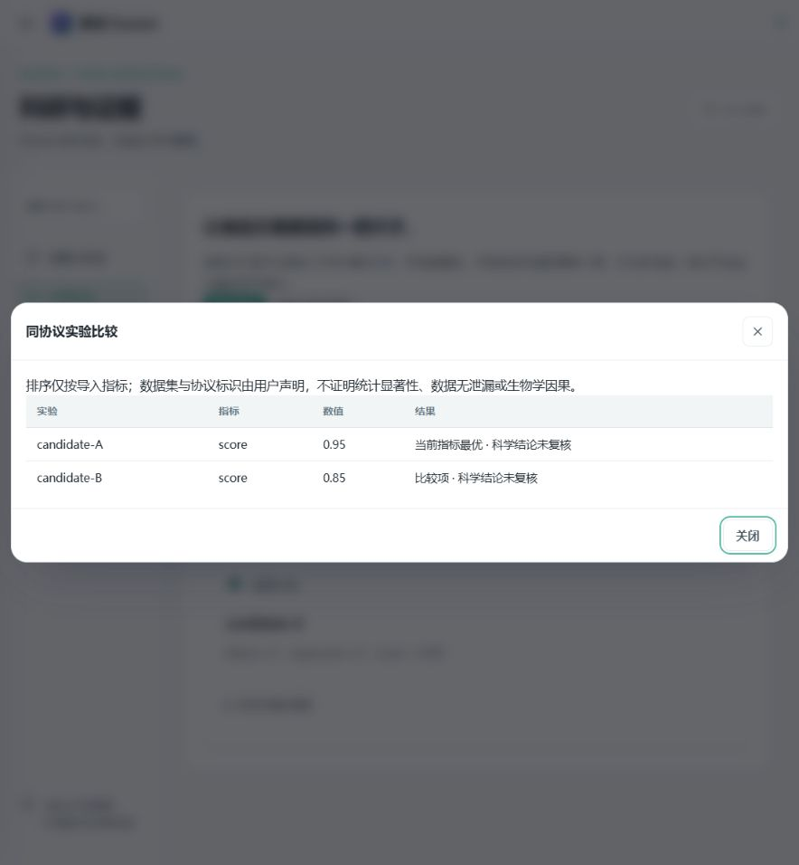

# 2.1 升级说明：把编排和验证放进执行过程

2.1 延续素问的单机部署方式，不改变已有工作区与配置目录。本轮补齐的是第二轮可实际运行的子项：并行子任务、自检协议、指标门控、实验比较及工作流文件交换。V2 清单中的团队权限、完整渠道适配和科研训练体系仍没有因此变成已完成。

## 对照的是哪一个书生版本

本轮依据 [Sage-A1.5 官方模型卡](https://huggingface.co/InternScience/Sage-A1.5) 和 [2026 年 10 月技术报告](https://arxiv.org/abs/2610.28578)，不是早先的 InternAgent 1.5。参考其并行协作、自检和可检查研究产物的组织方式；适配不等于重新训练了书生模型，也不继承上游的评测成绩。

## 模型自检与独立验证，分别配置

**设置 → 智能模型** 增加两个默认关闭的选项：

| 选项 | 实际行为 | 边界 |
|---|---|---|
| Sage-A1.5 自检 | 对模型名称包含 `Sage-A1.5` 的请求传递 `chat_template_kwargs.verification=true` | 需要兼容的实际模型服务；其他模型与备用模型不会收到此参数 |
| 并行子任务 | 暴露 `spawn_subagent` 工具，按输入顺序返回结构化研究结果 | 沿用 Agent 工具审批、工作区预算、全局子任务与深度限制；没有自动安装搜索服务 |

自检属于模型自己的推理过程。素问的文件指标检查与人工科学复核是另外两层，不会因为模型自检或多模型共识就自动通过。

已有 OpenAI 兼容端点可直接使用；模型名称填 `InternScience/Sage-A1.5`，地址填你实际启动的服务。权重、GPU 环境及推理服务由使用者准备。本轮没有下载权重，也未在真实 Sage 服务上完成质量评估。

## 独立子任务的输入与输出

每个任务必须提供 `task`、`context`、`expected_output` 三段说明。子任务不会获得父会话全文；当前实现沿用父 Agent，避免通过任意切换角色扩大权限。批次最多 5 个，且进一步受原有 `max_child_tasks` 限制，默认因此最多 4 个；超限拒绝，不静默丢弃。

返回记录包含 `answer`、`status`、`evidence` 和 `unresolved_issues`。结果不是有效 JSON 时标为 `unknown`；来源 ID 不存在于当前工作区时标为 `insufficient_evidence`。`completed` 仅表示回答完成，`scientific_status` 仍是 `unverified`。来源存在也不代表引文支持了论断。

并行任务只共享经显式授权的工作区。它们有独立会话，但计算工具仍使用该工作区共享内核并串行访问；需要彻底隔离文件或变量时，应使用不同工作区。

## 工作流里的指标门控

新增 `verify` 节点：

```json
{
  "id": "validate",
  "type": "verify",
  "depends_on": ["analysis"],
  "path": "results/metrics.json",
  "rules": [
    {"metric": "validation_score", "op": "ge", "threshold": 0.8}
  ]
}
```

此处数值只是格式示例，阈值应由研究设计决定。节点从所选本地或 SSH 工作区读取实际 JSON，记录内容 SHA256 和逐项检查。缺少指标、非有限数值或检查失败会停止后续依赖步骤，并在节点中保留失败原因。修正数据或方案后，检查外部操作状态，再恢复任务；已完成节点不会被重放。

支持 `lt/le/gt/ge/eq`，不执行任意判断表达式。验证节点不是统计学审稿器，也不会自动改写分析代码。循环节点、自动策略进化和湿实验接口仍在后续范围中。

## 实验比较与可交换流程

**科研与证据 → 实验比较**：运行分析并保存 JSON 指标后，登记名称、数据集版本、协议版本、文件路径、目标指标和优化方向。选中至少两项实验，系统只比较这些标识都相同的记录，保留并列最优项。

记录是“导入的计算指标”，不是平台重新执行过的 benchmark。数据集与协议标识由用户声明，指标文件摘要由平台实际计算；不能据此排除数据泄漏、混杂或证明显著性。

工作流页面支持 JSON 导入/导出。导入先检查 Schema、节点和依赖，生成新的模板 ID，不立即执行。导出采用脱敏处理，含凭据的原始参数可能变成占位值，导入后需要检查并重新配置。

| 接口 | 用途 |
|---|---|
| `GET/POST /api/platform/experiments?scope=...` | 查看或登记实验指标 |
| `POST /api/platform/experiments/compare?scope=...` | 请求体 `{"ids":["experiment_a","experiment_b"]}` |
| `GET /api/platform/workflows/{id}/export?scope=...` | 导出 Schema 1 模板 |
| `POST /api/platform/workflows/import?scope=...` | 导入 `schema_version` 与 `workflow` |

## 验证与剩余工作

全量回归 **446 项通过**。新增检查覆盖批次限制、并发、来源 ID、结构化输出、父任务工具权限上限、指标门控失败/恢复、跨协议比较拒绝、模板校验与 Sage 参数隔离。外部模型测试使用协议替身，不能代替真实模型验收。

本轮没有提供模型权重训练、RSI 自动微调、完整科研 benchmark、任意策略自动修改或团队 RBAC。当前默认配置仍可使用离线 mock；真实分析能力取决于所配置的模型、工具及数据环境。

<p align="center"></p>
<p align="center"><sub>界面验收数据：0.95 与 0.85 是回归测试输入，不是真实生物学研究结果。</sub></p>

本机 HTTP 验收另覆盖：模板导入后不执行、验证失败拦截输出、修正文件后恢复，以及读取实际指标并比较。页面操作验证了选择实验与排名展示，浏览器未记录错误。
