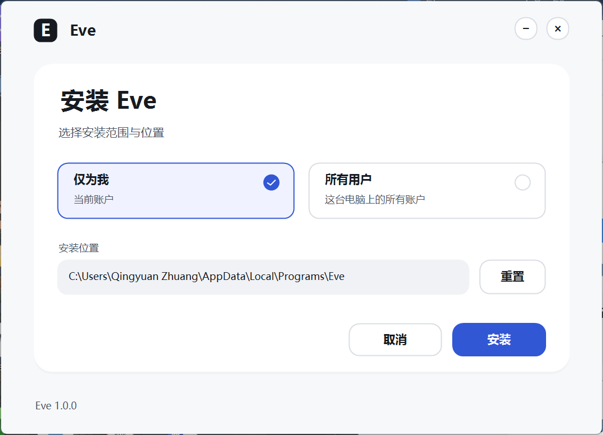
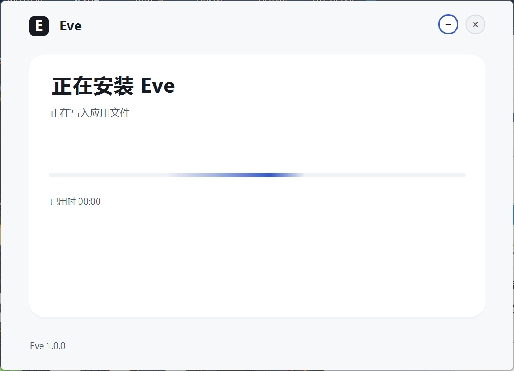

# Agent4Sci 技能与安装界面验收

日期：2026-10-30。源分支：`main`，基线提交 `75a2e1c`；本轮改动保留在工作树，未推送或覆盖 GitHub Release。工作树包含此前的文献、设置和窗口改动，本轮没有回滚这些内容。

## 科研技能

从 [Agent4Sci 论文](https://arxiv.org/abs/2610.28763) 和[官方仓库](https://github.com/maszhongming/agent4sci/tree/74b0e8c4dc55610072bed4326b6bfac24dc77377)适配：

| 论文技能 | Eve 技能 | 接入位置 |
| --- | --- | --- |
| Skill 1 · Research | `agent4sci-research-ideation` | 资源侦察、证据矩阵、可证伪假设 |
| Skill 3 · Checklist | `agent4sci-research-checkpoint` | 预注册、分析、实验设计、图表及连续推进边界 |

Skill 2 未安装。技能正文按需加载；每个 `next_actions` 条目提供阶段技能名称，模型根据检索返回的真实 ID 加载。科研构思分领域与计算方法两条文献线；检查点保留失败原因、资源、预算与具体行动。工作继续使用既有 `RunService`、阶段产物和人工复核门禁。

来源固定为 `74b0e8c4dc55610072bed4326b6bfac24dc77377`；Apache-2.0 全文与适配声明已加入桌面许可证和 NOTICE。两项技能可由桌面注册表实际发现和加载，构建后的本地注册包数量为 42，其中 34 项来自 `omicslab/skills`，与桌面自带技能有名称去重。该数量不包含共享科学技能库。

## 安装界面

安装包使用统一绘制的独立前端。文字、卡片、范围选择、路径栏、按钮和进度均使用一套设计令牌；不再在公开安装页叠加 NSIS 位图与原生文字控件。配色与主程序灰阶、蓝色强调色保持一致。

| Before | After | Why |
| --- | --- | --- |
| 位图、文字与交互控件分别定位 | 同一绘制与布局体系 | 减少错位、背景色块和字体风格混杂 |
| 标题与说明行距拥挤 | 统一标题、正文、辅助文字层级 | 安装范围与主要操作更容易识别 |
| 选中状态只改变文字和勾号 | 选项卡填色、边框与勾号同步 | 范围选择更明确 |
| 原生进度控件 | 圆角流动渐变与真实耗时 | 提供运行状态反馈，避免虚构百分比 |
| 安装结束依赖退出状态 | 核对文件存在与构建编号 | 版本不匹配时保留失败并允许重试 |

实际公开安装包窗口：



下图来自真实安装前端窗口，运行状态由本地协议夹具驱动：



主机显示缩放为 150%。代码包含 DPI 变化处理；本轮未在第二台显示器或其他缩放配置实测。界面遵循系统动画开关；运行中只更新进度区域，完成或失败后停止动画定时器。

## 验证

| 检查 | 结果 | 范围 |
| --- | --- | --- |
| Python 全量 | 933 passed、2 skipped、1 warning | 当前工作树的软件回归 |
| 技能与许愿流程最终回归 | 203 passed | frontmatter、依赖、阶段技能、连续推进与证据约束 |
| 桌面全量 | 267 passed、1 skipped、0 failed | 包含真实技能注册与加载 |
| TypeScript 类型检查 | 通过 | 桌面源码 |
| 安装配色与布局 | 3 passed | 正文/按钮对比度与操作区域间距 |
| 安装前端窗口 | 8 项交互检查与脚本完成标记通过 | 范围切换、路径拦截、引擎失败、重试、运行态、核验完成、退出 |
| 打包态应用 smoke | 10 项通过 | 实际 Electron、Python、HTTP 协议夹具、持久任务、关闭/重连与 Dashboard |
| 最终应用文件 | 939 项哈希一致 | 与 smoke 受测包比较；不含运行后产生、且不进入安装包的 98 项 Python 字节码 |
| 安装包 SHA-256 与 blockmap | 通过 | 摘要匹配，blockmap 文件覆盖字节数匹配 |

记录：[安装交互](installer-ui-results.json)、[应用 smoke](packaged-smoke-result.json)、[文件一致性](runtime-identity.json)、[安装包元数据](installer.json)、[校验和](SHA256SUMS.txt)。

复现：

```powershell
python -m pytest tests/test_skills.py tests/test_research_wishes.py -q
npm --prefix desktop test
npm --prefix desktop run dist:win -- --config.directories.output=release/agent4sci-ios-final
powershell -NoProfile -ExecutionPolicy Bypass -File desktop/scripts/test-installer-ui.ps1 -PackageDir desktop/release/agent4sci-ios-final -OutDir docs/verification/agent4sci-ios-20261030
```

## 产物与体量

安装包：`desktop/release/agent4sci-ios-final/Eve-Setup-1.0.0-win-x64.exe`。

- 大小：143,032,985 bytes；同轮第一版为 142,924,407 bytes，增加 108,578 bytes（0.076%）。
- SHA-256：`ed0a0b6a9e9fb5db438561602eee54b84d764fdb7720bdd59749dc9afd9ebd67`。
- 应用构建编号：`fe699eb4ce32cba9a52a76f2d2526e664a8b9aa80c9c6176d6b7e6e7e6a0c453`。
- 新安装前端由 .NET Framework 执行，不进入应用的 JavaScript bundle。

## 验证边界

安装前端的失败、重试和完成使用明确标记的本地进程夹具，不是实际 NSIS 安装生命周期测试；本轮未覆盖现有用户安装。公开封装已实际启动并显示新前端。所有用户模式的真实系统确认、干净 Windows 虚拟机、完整升级矩阵和代码签名未验证。运行需要 Windows 10/11 x64 与 .NET Framework 4.8，安装包未签名。卸载界面继续使用既有实现。

应用 smoke 使用本地模型协议夹具与真实执行组件，不代表真实模型科研质量。未执行付费模型科研基准，也不声称 Eve 获得论文报告的性能提升。说明见 [科研流程](../../WISH-RESEARCH.md)与[安装设计](../../INSTALLER-DESIGN.md)。
