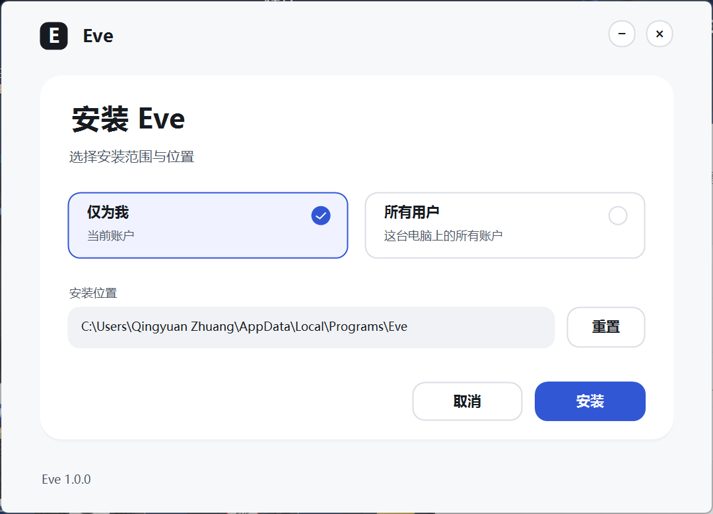
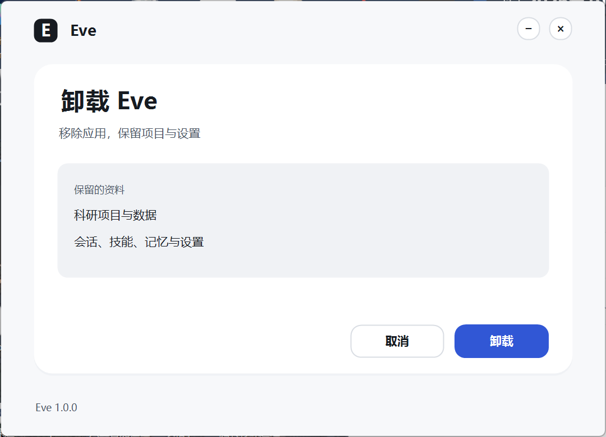

# Eve 1.0.0 发布验收

验收日期：2026-10-30。Windows x64，发布标记 `eve-v1.0.0-20261030-r2`。

## 本轮修复

- 安装与卸载共用同一绘制前端：中性灰表面、蓝色主操作、统一文字层级、键盘焦点与按压反馈。
- 卸载提供确认、进度、完成与失败重试；取消时保留应用，移除后保留用户目录里的会话、项目、技能、记忆和设置。
- 进度使用不定量流动效果与实际耗时；遵循系统减少动画设置，完成后停止刷新。
- 修复静默安装的 `/D` 路径被外层 NSIS 消费及未指定范围时的等待问题。
- Python 依赖先安装到全新暂存目录，导入校验后切换；切换失败恢复旧目录，避免不同 Python 版本的二进制残留污染。
- 修复旧后台 PID 被其他进程复用后阻止新后台启动的问题。
- PDF 必需依赖包含 `pypdf`；解析移出事件循环并区分加密文件错误。
- 模型支持命名供应商、多模型及各模型独立上下文、输出、温度、模态配置。
- 文献雷达支持留空探索、服务器持有后台任务、来源级状态、合并请求、缓存、限流与有界重试；页面切换不取消任务。
- 任务预算耗尽保留检查点并写回会话；失败通知按状态变化去重，耗时刷新保持安静。

## 验证结果

| 检查 | 结果 |
| --- | --- |
| Python 全量回归 | 945 passed / 2 skipped / 1 warning |
| 桌面单元与集成 | 275 passed / 1 skipped / 0 failed（276 项） |
| TypeScript | 通过 |
| Edge 前端 | 10/10 套件通过，见 [frontend-results.json](frontend-results.json) |
| 打包态实时 smoke | 11/11 通过，复用已校验的受管 Python 环境 |
| 安装器生命周期 | 10/10 通过：安装、文件、注册表、启动、后台健康、窗口关闭后存活、重装、卸载、数据保留、注册表清理 |
| 安装前端 | 9/9，通过实际窗口操作；引擎失败/重试由本地协议夹具验证 |
| 实际卸载前端 | 5/5：确认、取消保留应用、运行状态、实际移除文件、完成退出 |
| 六类文献源 | 实际 Eve 适配器均返回 2 条：PubMed、medRxiv、Europe PMC、OpenAlex、bioRxiv、arXiv |
| 生产依赖审计 | 0 vulnerabilities，9 个生产依赖 |
| 静态凭据扫描 | 0 HIGH / 328 LOW，20 个测试夹具已登记 |

Python 跳过项与桌面跳过项来自宿主不能创建符号链接。警告来自 FastAPI/Starlette 的 httpx 迁移提示。完整报告按各文件中的执行时间与边界解释。

## 安装包

- 文件：`Eve-Setup-1.0.0-win-x64.exe`
- 大小：143,071,342 bytes（136.44 MiB）
- SHA-256：`b4c30a63bef9fb13758fae9e19081fb2cce3538b322a20cb68085fa25595fd07`
- 构建：`d03b67eaefff67daa0d9efa212676f66b9c964c3b525038ad228b43d7ad417a9`
- 安装包未签名。

## 截图





## 证据

[安装包清单](installer.json)、[校验和](SHA256SUMS.txt)、[生命周期](installer-lifecycle.json)、[安装窗口](installer-ui-results.json)、[卸载窗口](uninstaller-ui-results.json)、[打包态 smoke](packaged-live-smoke.json)、[六源探测](source-probe.json)、[性能](performance.json)、[生产依赖](npm-audit.json)、[SBOM](sbom.cdx.json)、[安全扫描](security-scan.json)。

同机性能样本：后台冷启动 P50 959.89 ms，RPC create P50 1.042 ms，事件流 P50 2.742 ms。短时样本含主机负载影响，不能作为跨机器加速结论。

## 复现

```powershell
python -X utf8 -m pytest -q
npm --prefix desktop test
npm --prefix desktop run typecheck
npm --prefix desktop run dist:win
powershell -NoProfile -ExecutionPolicy Bypass -File desktop/scripts/verify-installer.ps1 -Installer desktop/release/Eve-Setup-1.0.0-win-x64.exe -Version 1.0.0 -OutFile docs/verification/eve-1.0.0-release/installer-lifecycle.json
powershell -NoProfile -ExecutionPolicy Bypass -File desktop/scripts/test-installer-ui.ps1 -PackageDir desktop/release -OutDir docs/verification/installer-current -InstalledDirectory '<专用测试安装目录>'
```

## 验证范围

全新隔离 profile 的首次依赖下载曾超过 smoke 的 120 秒等待；最终打包态 smoke 复用已校验的受管 Python 环境，首次环境修复由实际安装生命周期覆盖。实际安装与卸载为当前 Windows 主机的逐用户流程；所有用户界面与路径选择已测，提权安装/卸载、干净 VM 和跨大版本升级矩阵未测。公共源探测使用固定历史日期窗口，证明请求与解析成功，不能保证当前索引完整或长期可用。打包态聊天模型使用本地 HTTP 协议夹具，公共文献接口用真实网络；测试不证明科研结论正确性。静态扫描不等于渗透测试；未执行 8/24/72 小时耐久验证。
