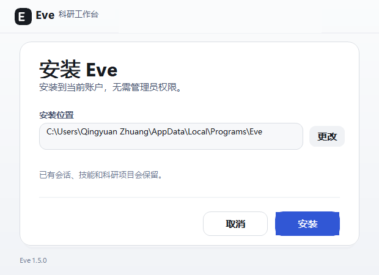
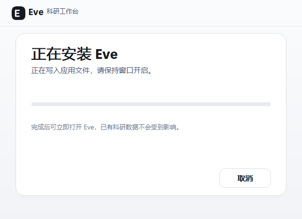
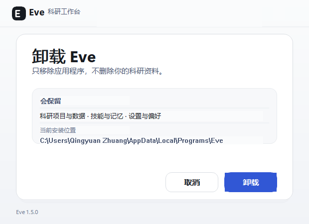
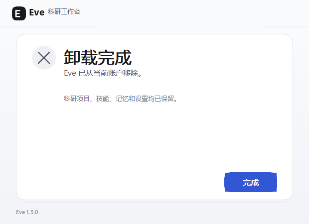

# Eve 1.5.0 Windows 安装器验收

> 验收日期：2026-10-30
>
> 目标平台：Windows x64
>
> 安装包：`Eve-Setup-1.5.0-win-x64.exe`（未签名）

## 交付结论

安装与卸载界面已改为与主程序浅色工作台一致的品牌化流程。标准 MUI 欢迎页、进度页、完成页和原生 `Back / Next / Cancel` 按钮均不显示；主按钮、次按钮、输入框、窗口控制、卡片和状态文字由自定义页面绘制。

| 流程 | 页面 | 结果 |
| --- | --- | --- |
| 安装 | 欢迎、进度、完成 | **11/11 检查通过** |
| 卸载 | 确认、进度、完成 | **9/9 检查通过** |
| 窗口尺寸 | 六页统一 | `620 × 450` |
| 打包态安装包 | NSIS x64、逐用户 | 通过 |
| 标准 MUI 页面回退 | 禁止 | 未出现 |
| 可见原生按钮 | 禁止 | 未出现 |

NSIS 底层仍使用 Win32 窗口与基础控件 API；本轮完成的是标准向导外观、原生按钮和默认 MUI 页面的完整替换，不应表述为安装器完全不使用 Win32。

## 设计对齐

- 主色：`#3157D5`，只用于“安装 / 打开 Eve / 卸载”等主要操作。
- 中性色：`#FAFBFC`、`#FFFFFF`、`#F7F8FA`、`#E8EBEF`、`#495570`、`#171B21`。
- 字体：`Segoe UI Variable Display` 用于标题，`Microsoft YaHei UI` 用于中文正文。
- 顶栏：统一 Eve 标识、产品名、拖动区、最小化和关闭入口。
- 按钮：同一页面保留一个主操作与至多一个次要操作，尺寸与圆角一致。
- 安装：逐用户安装，无需管理员权限；可通过“更改”选择目录。
- 卸载：只移除应用文件，保留科研项目、数据、技能、记忆和设置。
- 完成页：安装后可立即打开 Eve；卸载完成直接退出，不回到原生完成页。

## 页面证据

| 欢迎 | 安装进度 |
| --- | --- |
|  |  |

| 安装完成 | 卸载确认 |
| --- | --- |
|  |  |



截图来自打包后的真实 NSIS 程序，使用 `PrintWindow` 捕获后用同一窗口的文本控件合成，避免远程桌面壁纸或背景遮挡。页面结构和可见文本同时记录在 `page-transitions.json` 与 `uninstaller-page-transitions.json`。

## 自动化检查

安装探针：

- 欢迎页渲染并加载 `installerWelcome.bmp`。
- 点击自定义“安装”可推进到进度页。
- 进度页渲染并加载 `installerProgress.bmp`。
- 无可见原生按钮。
- 完成页渲染并加载 `installerFinish.bmp`。
- 点击自定义“完成”可正常退出。
- 应用与卸载程序均实际写入安装目录。

卸载探针：

- 确认页渲染并加载 `installerUninstall.bmp`。
- 自定义“卸载”可推进到安装文件页。
- 完成页渲染并加载 `installerUninstallFinish.bmp`。
- 无可见原生按钮。
- 完成页可正常退出，不出现第二个原生完成页。
- 应用文件被移除，用户数据保留策略未改变。

复现：

```powershell
powershell -NoProfile -ExecutionPolicy Bypass `
  -File docs/verification/installer-1.5.0/exercise-installer-ui.ps1 `
  -FinishTimeoutSeconds 90

powershell -NoProfile -ExecutionPolicy Bypass `
  -File docs/verification/installer-1.5.0/exercise-uninstaller-ui.ps1 `
  -FinishTimeoutSeconds 90
```

## 边界

- 未在干净 Windows VM、跨大版本升级矩阵或企业软件分发环境中验证。
- 安装包未签名，Windows SmartScreen 仍可能显示未知发布者提示。
- 自动化窗口探针验证控件、尺寸、文本、页面转换和退出行为，不等同于人工视觉验收或高 DPI 全矩阵验收。
