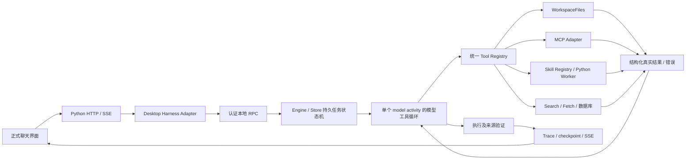

# 根因、改造与边界

| 根因 | 原路径与结果 | 修改 |
|---|---|---|
| 工作目录没有传到工具层，read_file 只承认附件白名单 | 正式聊天即使处于工作区，也无法列目录、查找和读普通文件 | Python Adapter 传 workspaceRoots；WorkspaceFiles 统一目录子树和精确文件授权；新增列表、搜索、分页读取与写入 |
| 正式页面输出预算固定 2048；provider 把 length 当普通错误丢弃部分结果 | 长回答或 Function Calling 参数被截断后整轮失败 | 读取用户 max_tokens，默认 8192；专门的截断错误保存文本、Token、是否含工具；内循环有限接续、扩大预算，受任务预算约束 |
| 每个工具各占一个大卡片，历史步骤没有完整还原 | 工具多时正文被挤走，重开会话时过程不一致 | 每条回答一个执行记录分组；子步骤扁平化；更新幂等并清理旧状态类；保存 tool_steps 以恢复历史 |
| 基础技能没有自动安装；正式页和原生 Registry 不一致 | 名称可见不代表能加载/执行，两个页面启停不同步 | 启动幂等安装 8 个真实包；共用 list/load/enable/disable/remove；区分 instructions 与 executable |
| 技能入口正文引用的参考资料无法读取 | 官方 creator 引用 references，模型却没有对应入口 | skill_load 只列资源元数据，skill_read_resource 在校验整包摘要后读取单个文本资源 |
| 旧 daemon 可被新 UI 无条件复用 | 用户升级 UI 后仍运行旧工具实现 | 协商 app/daemon 版本；空闲后台退出后启动新版本；存在未完成任务则明确阻止切换；实际旧 3.3.2 测试两分支均通过 |
| MCP 清理仅以 close 事件判断退出，等待窗口很短 | 压力下 Windows 已退出进程的管道关闭延迟，成功工具也抛 cleanup 错误 | 以 exit/close 幂等记录实际终止，释放计数；分阶段有界清理并销毁管道；仍拒绝真实未退出进程 |

具体文件和行号在 code-locations.csv；最初失败日志保留在 unit-initial-failure.txt、unit-mcp-cleanup-failure.txt。第一次打包遇到旧 win-unpacked 正在运行的文件锁，记录在 build-locked-old-output.txt，改为独立 release/product-340 输出目录，没有结束该旧应用。

开发回归记录：新增历史运行入口时曾错误引用未绑定的 run_id，造成 TS 任务完成、Python 投影失败。刷新验收发现了此错误（history-regression-failure.txt），已改为从 Adapter kwargs 取值，并在 UI E2E 增加 Python run 与 TS Harness 必须同时成功的断言。仅看 TS completed 不足以证明正式聊天成功。

## 一个执行核心

Engine 继续独占任务调度、取消、暂停/恢复和状态持久化；runAgent 是一个 activity 内的 Function Calling 协议循环。已有多模型辩论、裁判、科学工具、历史会话、用户配置和 Python Worker 保留。

## 本轮没有证明的能力

1. 供应商 HTTP 429 仍阻断当前版本真实模型验收。3.3.2 的 22/22 是历史结果，不是 3.4.0 的通过证明；当前固定 22 项不能通过门槛。
2. 截断恢复经过真实 provider 解析器、受控 SSE、真实工具和正式界面验证；当前没有真实供应商长输出成功样本。最多三次接续后会失败并保留部分证据，不能保证无限长输出。
3. 文件工具支持 UTF-8 文本，最大 20MB、分页与结果限长；二进制 PDF、Word 等不能用此入口读取，尚未新增文档解析器。超长单行内容会明确 truncated，没有字节续读接口。
4. 路径规范化与运行目录隔离不是操作系统安全沙箱。Python 仍由现有 Worker 执行；生成/远程技能受静态扫描和权限检查，不能声称能防御任意恶意代码或本地并发路径替换。
5. 远程安装支持公共 GitHub tree URL、固定解析 SHA、大小/数量限制；不支持私库登录、任意 Git 托管或包含斜杠的 ref。被静态检查拦截的包不会绕过检查自动安装。用户本地安装目录需 skill.json 和 SKILL.md。
6. OpenAI creator/installer 是保留参考资源的工作流适配，不意味着任意上游脚本都能直接执行。3 个内置 Python 包已真实运行；缺依赖会明确失败，不会自动修改系统 Python。
7. 新版本未安装覆盖生产应用，未做无 Python 的干净 Windows 安装/卸载验收。打包使用已提交旧版 Python 基线加本轮六个明确文件覆盖，排除共享目录里无关的 CLI / integrations 未提交工作。
8. 外部项目 登录后交互和云 Agent Loop 未获运行验证；局部静态分析有资源上限，见 claws-analysis.md。

这些项目未计为通过；本轮不宣称所有 P0 已关闭。
